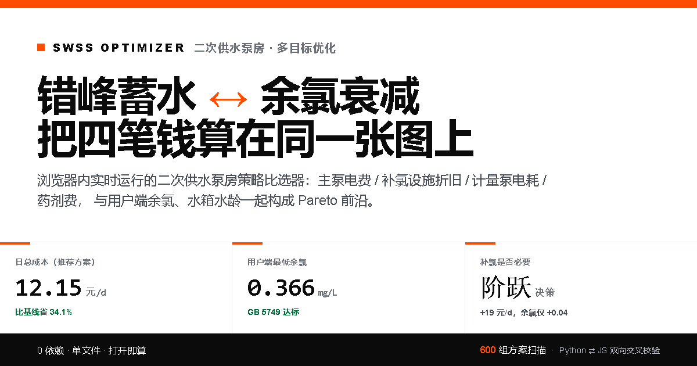

# SWSS Optimizer · 二次供水泵房错峰蓄水 ↔ 余氯衰减 多目标优化模拟器

> v2 · 2026-10-12

浏览器内实时运行的单文件交互 Demo，用于比选二次供水泵房的**错峰蓄水策略**与**二次补氯策略**。

**核心问题**：屋顶调蓄水箱越大、维持液位越高，错峰电价收益越好，但水龄变长、余氯衰减越多；补氯能提高余氯，却会让日运行成本出现一次性的阶跃。这个工具把四笔钱放在同一坐标系里算清：

1. 主泵提升电费
2. 补氯设施折旧摊销（全成本口径）
3. 补氯计量泵电耗
4. 次氯酸钠药剂费



## 快速打开

**在线 Demo（推荐，已上线）**：<https://menglingbang74-droid.github.io/swss-optimizer/>

或者本地直接双击（无需服务器、无第三方依赖）：

```bash
web/index.html
```

> 部署与维护说明见 [DEPLOY.md](DEPLOY.md)。

## 验证结果

一条命令跑完前四层（不需要浏览器）：

```bash
python verify.py            # 或者 python verify.py --browser 带上真实浏览器层
```

| 层级 | 命令 | 状态 |
|---|---|---|
| Python 模型自测 | `python test_v1.py` | 全部断言 PASS |
| Python 侧基准值 | `python xcheck.py` | 写出 `out/xcheck.json` |
| Python ↔ JS 交叉校验 | `node xcheck.js` | **250/250 一致**（含 NaN 判 FAIL 防假通过） |
| Node DOM 桩冒烟 | `node smoke.js` | ALL PASS |
| Chromium 真实浏览器 | `python browser_check.py` | ALL PASS · 控制台零错误 |

## 项目结构

```text
swss/
  model.py            # 核心仿真（CSTR + 一级余氯衰减 + 分时目标液位 + 成本分解）
web/
  template.html       # 模板（开发入口）
  index.html          # 构建产物（含内嵌 Pareto 数据，可直接打开）
  og.png              # 社交分享图（由 make_og.py 生成）
run_v1.py             # 决策空间扫描，生成 out/pareto.json
build.py              # 把 pareto.json 注入模板
verify.py             # 一键跑完整验证链（顺序有依赖，别拆开跑）
xcheck.py / xcheck.js # Python 与 JS 模型逐字段交叉校验
test_v1.py            # 模型自测（解析解 / 守恒 / 策略方向性 / 成本分解 / 边界工况）
smoke.js              # 无浏览器冒烟测试（语法 + 运行时 + 交互 + 审计项回归锁）
browser_check.py      # Chromium 真实浏览器验证（布局/对比度/响应式/无障碍/指针目标）
make_og.py            # 生成 web/og.png
deploy.sh             # 一键上线：push + 开 Pages + 等部署（token 不落盘）
deploy_api.py         # 同上的 API 版（走 Git Data API，用于 github.com 被拦的网络）
DEPLOY.md             # 上线操作清单（含手动路径与部署后自查）
.github/workflows/pages.yml  # GitHub Pages 自动部署（带质量闸门）
```

> `out/` 是可再生产物，**不随仓库提交**。新克隆后请先 `python xcheck.py`
> 生成 `out/xcheck.json`，否则 `node xcheck.js` 会报缺文件（脚本会给出提示）。

## 主要假设与默认值

| 参数 | 默认值 | 说明 |
|---|---|---|
| 水箱容积 | 60 m³ | 30–200 m³ 可调 |
| 避峰阈值 | 1.05 元/kWh | ≥ 该电价的时段禁止补水 |
| 维持液位 | 85% | 允许补水时段目标液位 |
| 二次补氯 | 0 mg/L | 0–1.0 mg/L 可调 |
| 补氯装置投资 | 3.0 万元 | 2–5 万元参考区间 |
| 折旧年限 | 8 a | |
| 年运维费 | 3000 元/a | 标定、巡检、维护 |
| 有效氯单价 | 10 元/kg | 次氯酸钠 10% 溶液约 800–1300 元/t 折算 |
| 成本口径 | 全成本 | 可切换为"仅运行成本"（折旧视为沉没） |
| 余氯内控目标 | 0.05 mg/L | GB 5749 末梢限值，可抬高 |

## 关键结论（默认参数）

- **补氯是成本阶跃，不是连续调节**：从 dose=0 调到 0.1 mg/L，日总成本一次性增加约 19 元/d（主要来自设施折旧 + 运维）；之后从 0.1 加到 0.8 mg/L，总成本只再增加约 1.1 元/d。
- **药剂边际成本极低**：每多投 0.1 mg/L，药剂费只增加约 0.16 元/d。
- **默认工况下余氯不构约束**：内控目标 0.05 mg/L 时，不补氯也能达标，推荐方案为"大水箱 + 适度避峰 + 不补氯"。把 k₂₀ 或水温调高后，补氯才会成为必要。
- **真正的权衡轴是「维持液位」**（≈水箱平均存水量）：液位越高 → 电费越低、水龄越长、末端余氯越低，单调 Pareto 前沿。
- **避峰深度是 U 型**：过度避峰触发低液位保护，被迫在峰时段高价补水，电费反而反弹；最优点在阈值 1.05 元附近。
- **水箱容积决定错峰收益上限**：40 m³ 最多省约 13% 且被迫峰时补水；120 m³ 可省约 32.5% 且无需被迫补水。

## 诚实边界

- 参数为工程参考取值，**未经实测率定**。
- 水箱按完全混合反应器（CSTR）处理，未考虑短流、死水区与分层。
- 未计管网水锤、泵启停损耗、变频效率曲线细节。
- 补氯设施投资与运维为量级估计。
- 结论用于**策略比选与量级判断**，不作为设计依据。
- 引用规范编号仅用于说明取值依据：GB 50015（建筑给水排水设计标准）、
  GB 5749（生活饮用水卫生标准）、GB 17051（二次供水设施卫生规范）。

## 开发备忘

```bash
# 重新生成 Pareto 并构建 web/index.html
python run_v1.py && python build.py

# 重新生成社交分享图
python make_og.py

# 一键跑全部验证
python verify.py --browser
```

改 `web/template.html` 后**必须重新 build**，否则 `web/index.html` 与模板不一致
（验证链跑的是构建产物，不跑模板）。

## License

MIT — 可自由用于简历、作品集、面试演示，但请保留本说明与参数边界声明。见 [LICENSE](LICENSE)。

